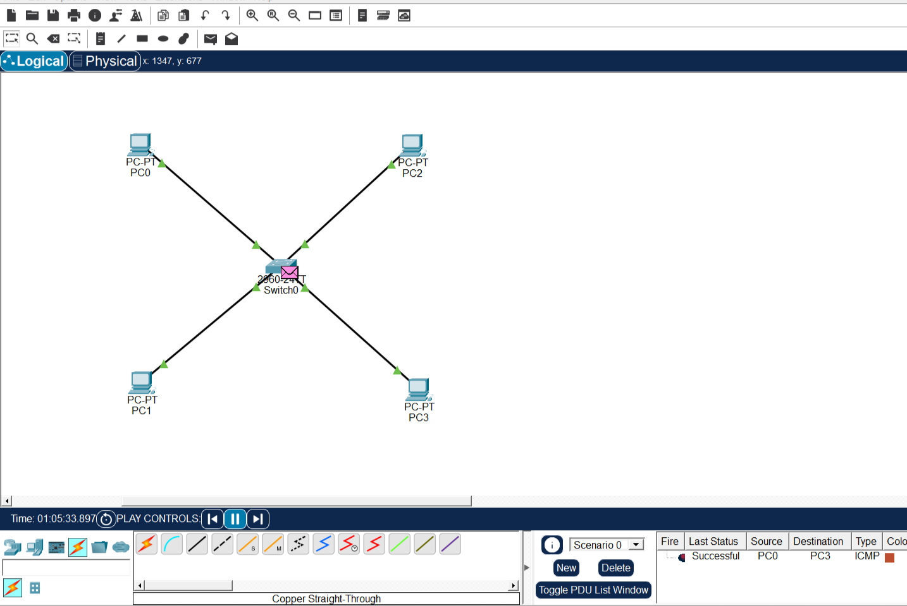
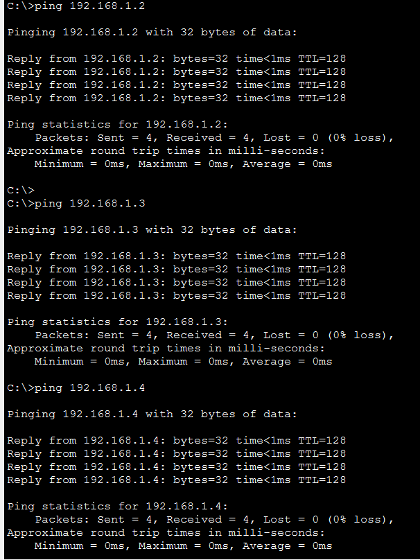

# Lab 02 – Basic LAN Setup

## Overview
This lab demonstrates how to build a basic Local Area Network (LAN) using Cisco Packet Tracer. Four PCs are connected through a Cisco 2960 switch to establish communication within the same network.

## Objectives
- Build a basic LAN topology.
- Connect multiple PCs using a network switch.
- Configure static IP addresses.
- Understand subnet masks.
- Test network connectivity using the Ping command.

## Network Topology
**Topology Type:** Star Topology

### Devices Used

| Device | Quantity |
|---|---:|
| Cisco 2960 Switch | 1 |
| PCs | 4 |
| Copper Straight-Through Cables | 4 |

## IP Addressing Scheme

| Device | IP Address | Subnet Mask |
|---|---|---|
| PC0 | 192.168.1.1 | 255.255.255.0 |
| PC1 | 192.168.1.2 | 255.255.255.0 |
| PC2 | 192.168.1.3 | 255.255.255.0 |
| PC3 | 192.168.1.4 | 255.255.255.0 |

**Network Address:** 192.168.1.0/24

**Default Gateway:** Not configured (same LAN communication).

## Physical Connections

| Device | Switch Port |
|---|---|
| PC0 | Fa0/1 |
| PC1 | Fa0/2 |
| PC2 | Fa0/3 |
| PC3 | Fa0/4 |

## Configuration Steps

1. Added one Cisco 2960 switch.
2. Added four PCs to the workspace.
3. Connected all PCs to the switch using Copper Straight-Through cables.
4. Configured static IP addresses on all PCs.
5. Verified physical connectivity through green link indicators.
6. Tested communication using the Ping command.

## Connectivity Testing

The following connectivity tests were successful:

| Source | Destination | Result |
|---|---|---|
| PC0 | PC1 | Successful |
| PC0 | PC2 | Successful |
| PC0 | PC3 | Successful |

**Ping Test Results:**
- Packets Sent: 4
- Packets Received: 4
- Packet Loss: 0%

## Skills Learned

- Basic LAN setup
- Cisco switch connectivity
- Static IP configuration
- Subnet mask configuration
- Ping and ICMP connectivity testing
- Basic network troubleshooting

## Tools Used
- Cisco Packet Tracer

## Project File
`CCNA_Lab_02_Basic_LAN_Setup.pkt`

## Lab Status
**Completed Successfully**
---
