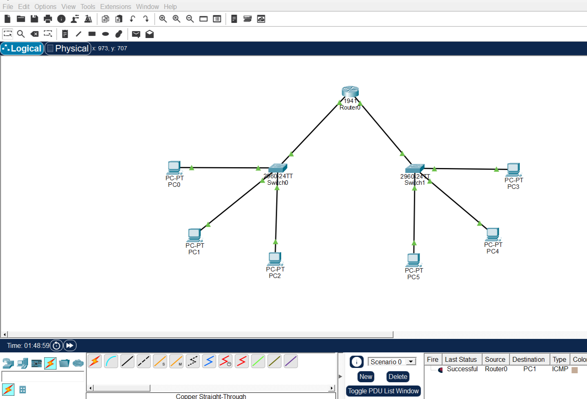
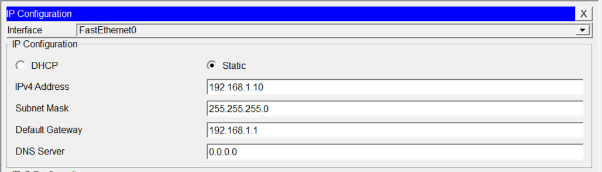
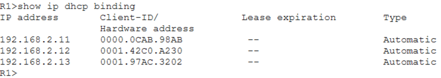
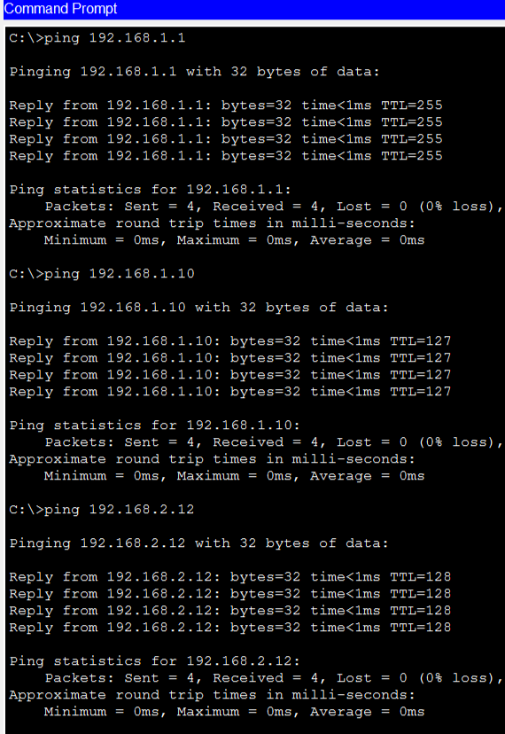

# Lab-03: Static IP Addressing and DHCP Configuration

## Overview

This lab demonstrates Static IP Addressing and Dynamic Host Configuration Protocol (DHCP) configuration using Cisco Packet Tracer.

Two separate LAN networks are connected through a Cisco 1941 router. Network 1 uses manually configured static IP addresses, while Network 2 uses DHCP to automatically assign IP addresses to connected devices.

## Objectives

- Understand Static and Dynamic IP Addressing.
- Configure static IP addresses on end devices.
- Configure a DHCP pool on a Cisco router.
- Exclude specific IP addresses from DHCP allocation.
- Verify DHCP address assignments.
- Test communication between two different networks.

## Network Topology

### Devices Used

- 1 Cisco 1941 Router
- 2 Cisco 2960 Switches
- 6 PCs
- 2 Separate LAN Networks

### Topology Diagram



## IP Addressing Scheme

### Network 1 — Static IP Configuration

**Network:** `192.168.1.0/24`

| Device | IP Address | Subnet Mask | Default Gateway |
|---|---|---|---|
| R1 G0/0 | 192.168.1.1 | 255.255.255.0 | — |
| PC0 | 192.168.1.10 | 255.255.255.0 | 192.168.1.1 |
| PC1 | 192.168.1.11 | 255.255.255.0 | 192.168.1.1 |
| PC2 | 192.168.1.12 | 255.255.255.0 | 192.168.1.1 |

### Static IP Configuration Screenshot



### Network 2 — DHCP Configuration

**Network:** `192.168.2.0/24`

| Device | Assigned IP Address | Configuration |
|---|---|---|
| R1 G0/1 | 192.168.2.1 | Static |
| PC3 | 192.168.2.11 | DHCP |
| PC4 | 192.168.2.12 | DHCP |
| PC5 | 192.168.2.13 | DHCP |

## Router Configuration

### 1. Interface Configuration

```cisco
enable
configure terminal

interface gigabitEthernet 0/0
ip address 192.168.1.1 255.255.255.0
no shutdown
exit

interface gigabitEthernet 0/1
ip address 192.168.2.1 255.255.255.0
no shutdown
exit
```

### 2. DHCP Configuration

DHCP was configured on Router R1 to automatically assign IP addresses to devices in Network 2.

```cisco
ip dhcp excluded-address 192.168.2.1 192.168.2.9

ip dhcp pool LAN2
network 192.168.2.0 255.255.255.0
default-router 192.168.2.1
dns-server 8.8.8.8
exit
```

### 3. DHCP Verification

The following command was used to verify dynamically assigned IP addresses.

```cisco
show ip dhcp binding
```

### DHCP Configuration and Bindings Screenshot



## Connectivity Testing

Connectivity was tested between devices within the same network and across different networks.

### Cross-Network Ping Test

From PC3 (`192.168.2.11`), the following command was executed:

```bash
ping 192.168.1.10
```

The ping test was successful, confirming communication between Network 2 and Network 1 through Router R1.

### Connectivity Testing Screenshot



## Verification Commands

The following Cisco IOS commands were used to verify network configuration.

```cisco
show ip interface brief
show ip dhcp pool
show ip dhcp binding
show running-config
```

## Lab Results

- Successfully configured static IP addresses on Network 1.
- Successfully configured DHCP on Network 2.
- Verified automatic IP allocation for three PCs.
- Confirmed communication between both LAN networks.
- Successfully tested inter-network connectivity through Router R1.

## Tools and Technologies

- Cisco Packet Tracer
- Cisco 1941 Router
- Cisco 2960 Switches
- IPv4 Addressing
- DHCP
- ICMP (Ping)

## Project Files

| File | Description |
|---|---|
| `Lab-03.pkt` | Complete Cisco Packet Tracer project |
| `README.md` | Lab documentation |
| `topology.png` | Network topology |
| `static-ip.png` | Static IP configuration |
| `dhcp.png` | DHCP verification |
| `connectivity-test.png` | Connectivity testing |

## Author

**Arsalan Younis**

GitHub: [Arslan-07](https://github.com/Arslan-07)

Repository: [Packet-Tracer-Lab](https://github.com/Arslan-07/Packet-Tracer-Lab)
