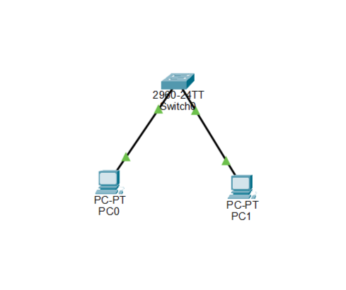
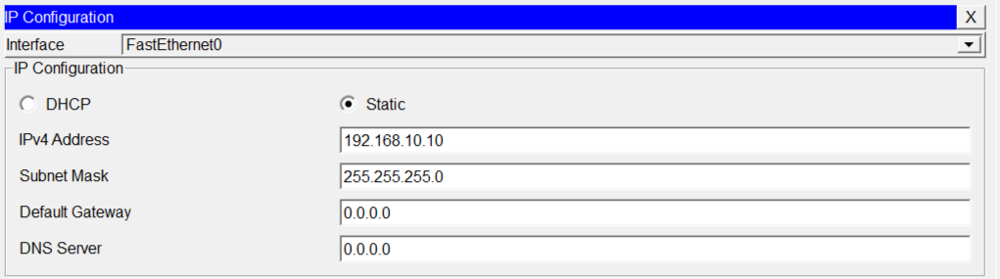
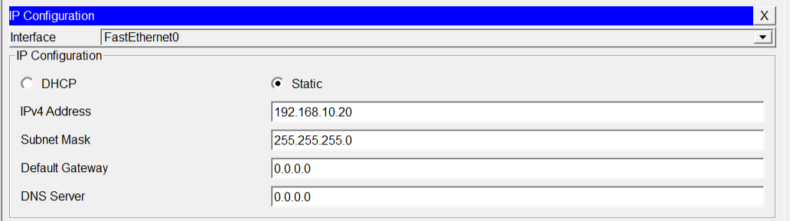
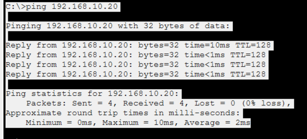

# Lab 04 – Subnet Mask Practice

## Overview

This lab focuses on understanding IP addressing, subnet masks, Network IDs, and basic network communication using Cisco Packet Tracer.

The practical demonstrates how two PCs communicate within the same network using a common subnet mask.

## Objectives

- Understand IP addresses and subnet masks.
- Identify Network ID and Host ID.
- Understand `/24` CIDR notation.
- Differentiate between same and different networks.
- Configure static IP addresses.
- Verify network connectivity using the ping command.

## Network Topology

Two PCs are connected to a Cisco 2960 switch using Copper Straight-Through cables.



## IP Addressing Table

| Device | IP Address | Subnet Mask | Network ID |
|---|---|---|---|
| PC0 | 192.168.10.10 | 255.255.255.0 | 192.168.10.0 |
| PC1 | 192.168.10.20 | 255.255.255.0 | 192.168.10.0 |

## IP Configuration

### PC0 Configuration

- IP Address: `192.168.10.10`
- Subnet Mask: `255.255.255.0`



### PC1 Configuration

- IP Address: `192.168.10.20`
- Subnet Mask: `255.255.255.0`



## Connectivity Testing

The ping command was used from PC0 to test connectivity with PC1.

**Command:**

```bash
ping 192.168.10.20
```

### Ping Verification



### Test Results

| Parameter | Result |
|---|---|
| Packets Sent | 4 |
| Packets Received | 4 |
| Packets Lost | 0 |
| Packet Loss | 0% |
| Minimum Time | 0 ms |
| Maximum Time | 10 ms |
| Average Time | 2 ms |

<details>
<summary>Key Concepts Learned</summary>

- Subnet Mask
- Network ID and Host ID
- CIDR Notation (`/24`)
- Same Network Communication
- Static IP Configuration
- Basic Network Connectivity Testing

</details>

## Tools and Devices Used

- Cisco Packet Tracer
- Cisco 2960 Switch
- Two PCs
- Copper Straight-Through Cables

## Lab Files

- `Lab-04.pkt` – Cisco Packet Tracer project file.
- `topology.png` – Network topology screenshot.
- `pc0-ip.png` – PC0 IP configuration.
- `pc1-ip.png` – PC1 IP configuration.
- `ping-verification.png` – Connectivity test results.

## Lab Status

**Successfully Completed**

## Author

**Arsalan Younis**

GitHub: [Arslan-07](https://github.com/Arslan-07)

Project Repository: [Packet-Tracer-Lab](https://github.com/Arslan-07/Packet-Tracer-Lab)
