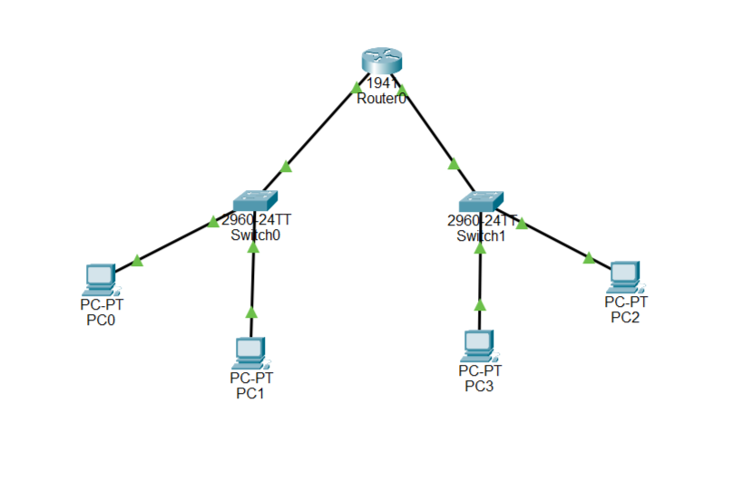
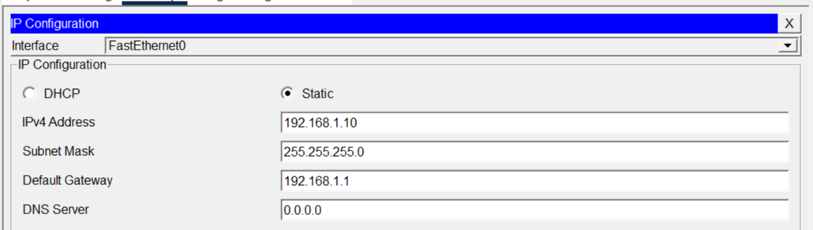
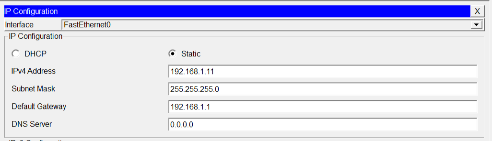
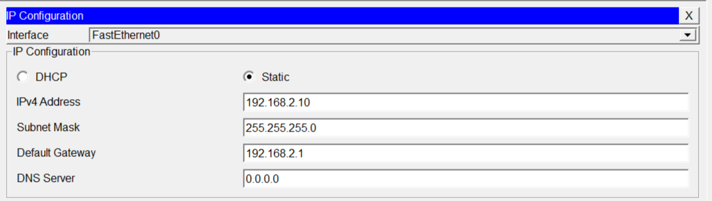
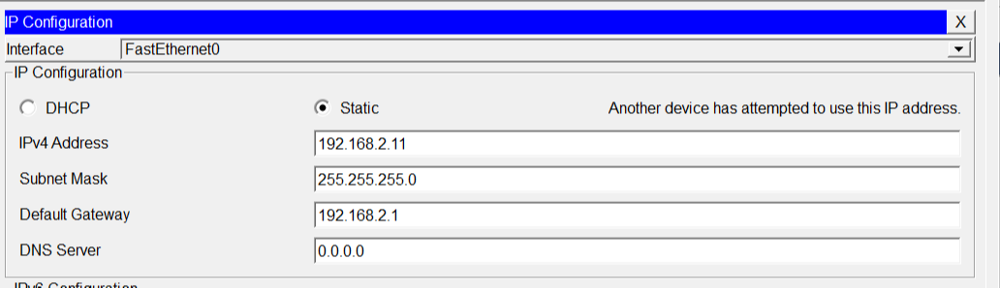
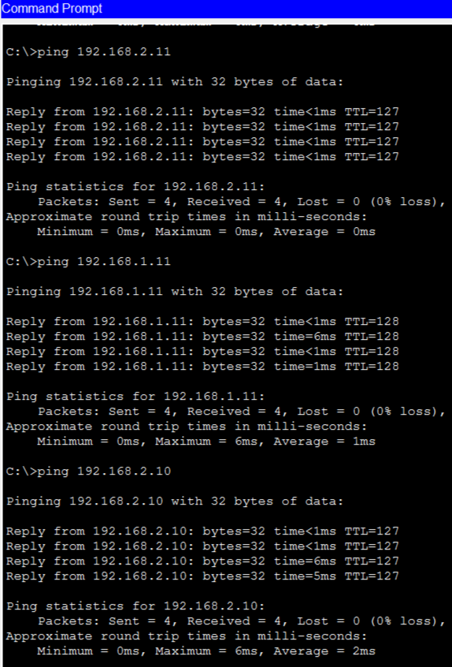

# Lab 05 – Default Gateway Basics


## 1. Overview

This lab focuses on understanding and configuring the **Default Gateway** in a network environment using Cisco Packet Tracer.

The primary objective is to understand how devices communicate within the same local network and how they access devices in different networks through a router.

## 2. Network Topology

The practical topology consists of two separate LAN networks connected through a Cisco router.

**Network Devices:**
- 1 × Cisco 1941 Router
- 2 × Cisco 2960 Switches
- 4 × End Devices (PCs)
- Copper Straight-Through Ethernet Cables

### Topology Diagram



## 3. IP Addressing Scheme

Two different IPv4 networks were configured for this lab.

| Device | IP Address | Subnet Mask | Default Gateway |
|:---|:---|:---|:---|
| PC0 | 192.168.1.10 | 255.255.255.0 | 192.168.1.1 |
| PC1 | 192.168.1.11 | 255.255.255.0 | 192.168.1.1 |
| PC2 | 192.168.2.10 | 255.255.255.0 | 192.168.2.1 |
| PC3 | 192.168.2.11 | 255.255.255.0 | 192.168.2.1 |

### Router Interface Configuration

| Router Interface | IP Address | Network |
|:---|:---|:---|
| GigabitEthernet 0/0 | 192.168.1.1 | 192.168.1.0/24 |
| GigabitEthernet 0/1 | 192.168.2.1 | 192.168.2.0/24 |

## 4. Router Configuration

The router was configured with two Gigabit Ethernet interfaces to connect both LAN networks.

### Cisco IOS Commands

```bash
enable
configure terminal

interface gigabitEthernet 0/0
ip address 192.168.1.1 255.255.255.0
no shutdown
exit

interface gigabitEthernet 0/1
ip address 192.168.2.1 255.255.255.0
no shutdown
exit

end
show ip interface brief
```

Both router interfaces were enabled and configured with their respective IP addresses.

## 5. End Device Configuration

All four PCs were assigned static IPv4 addresses, subnet masks, and the appropriate Default Gateway.

### PC0 – IP Configuration



### PC1 – IP Configuration



### PC2 – IP Configuration



### PC3 – IP Configuration



## 6. Connectivity Verification

Connectivity was verified using ICMP ping tests from different PCs to confirm communication within and between both networks.

### Ping Test Results

| Source Device | Destination Device | Destination IP | Result |
|:---|:---|:---|:---|
| PC0 | PC1 | 192.168.1.11 | Successful |
| PC0 | PC2 | 192.168.2.10 | Successful |
| PC0 | PC3 | 192.168.2.11 | Successful |
| PC2 | PC0 | 192.168.1.10 | Successful |

### Test 1: PC0 to PC1

```bash
ping 192.168.1.11
```

**Result:** 4 packets sent, 4 received, 0% packet loss.

### Test 2: PC0 to PC2

```bash
ping 192.168.2.10
```

**Result:** 4 packets sent, 4 received, 0% packet loss.

### Test 3: PC0 to PC3

```bash
ping 192.168.2.11
```

**Result:** 4 packets sent, 4 received, 0% packet loss.

### Test 4: PC2 to PC0

```bash
ping 192.168.1.10
```

**Result:** 4 packets sent, 4 received, 0% packet loss.

### Connectivity Verification Screenshot



**Final Verification:** All four documented ping tests completed successfully with 0% packet loss.

## 7. Key Learning Outcomes

Through this practical lab, I learned:

- The purpose and functionality of a Default Gateway.
- How to configure router interfaces using Cisco IOS commands.
- How to assign static IPv4 addresses to end devices.
- How routers forward packets between different networks.
- The difference between local network communication and inter-network communication.
- How to verify network connectivity using ICMP ping tests.
- Basic network troubleshooting techniques.

## 8. Conclusion

Successfully configured a Default Gateway environment using Cisco Packet Tracer.

Two separate LAN networks were connected through a Cisco router. Communication was verified between devices in the same network as well as across different networks.

All four documented connectivity tests were successful with 0% packet loss.

This practical exercise strengthened my understanding of IPv4 addressing, Default Gateway configuration, router interfaces, and inter-network communication.

---

**Author:** [Arslan Younis](https://github.com/Arslan-07)

**GitHub Repository:** [CCNA Packet Tracer Labs](https://github.com/Arslan-07/Packet-Tracer-Lab)
