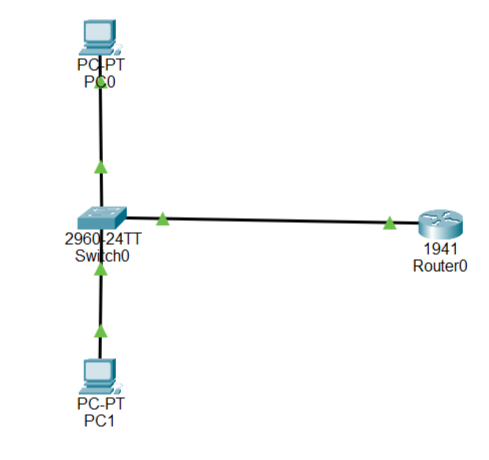
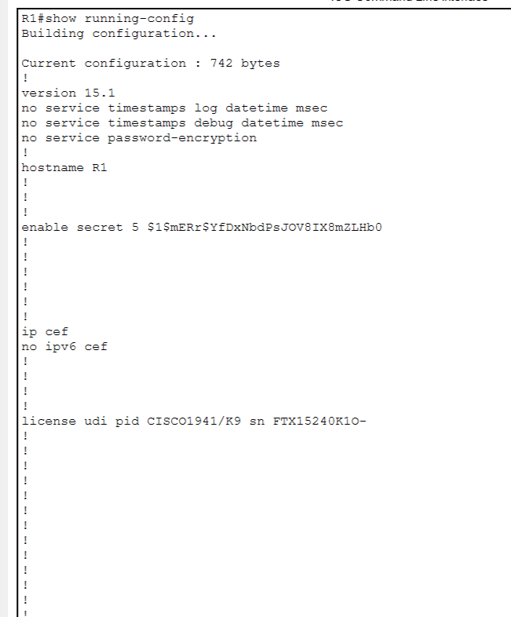
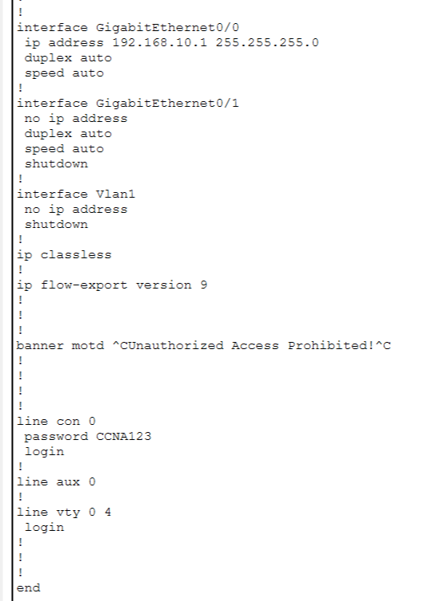
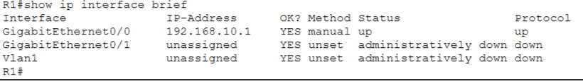
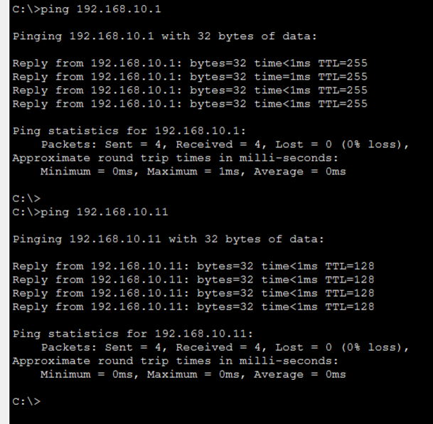

# Lab 06 – Router Basic Configuration

**CCNA Practical Networking Lab | Cisco Packet Tracer**

## Overview

In this lab, I performed basic Cisco router configuration using Cisco Packet Tracer. I configured the router hostname, enable secret password, console password, MOTD banner, and GigabitEthernet interface IP address.

I also verified interface status and tested network connectivity between PCs and the router.

## Objectives

- Configure router hostname.
- Configure enable secret password.
- Configure console password.
- Configure MOTD banner.
- Assign an IP address to the router interface.
- Enable the router interface using `no shutdown`.
- Configure PC IP addresses.
- Verify interface status.
- Test network connectivity using ping.
- Save router configuration.

## Network Topology



## Devices Used

- 1 × Cisco 1941 Router (R1)
- 1 × Cisco 2960 Switch (SW1)
- 2 × PCs (PC0 and PC1)
- Copper Straight-Through Cables

## IP Addressing Table

| Device | Interface | IP Address | Subnet Mask |
|---|---|---|---|
| R1 | G0/0 | 192.168.10.1 | 255.255.255.0 |
| PC0 | FastEthernet0 | 192.168.10.10 | 255.255.255.0 |
| PC1 | FastEthernet0 | 192.168.10.11 | 255.255.255.0 |

**Default Gateway:** 192.168.10.1

## Router Configuration

### 1. Configure Hostname

```bash
enable
configure terminal
hostname R1
```

### 2. Configure Enable Secret

```bash
enable secret CCNA123
```

### 3. Configure Console Password

```bash
line console 0
password CCNA123
login
exit
```

### 4. Configure MOTD Banner

```bash
banner motd #Unauthorized Access Prohibited!#
```

### 5. Configure Router Interface

```bash
interface gigabitEthernet 0/0
ip address 192.168.10.1 255.255.255.0
no shutdown
exit
```

### 6. Save Configuration

```bash
end
copy running-config startup-config
```

## Router Configuration Screenshots

### Router Configuration – Part 1



### Router Configuration – Part 2



## Interface Verification

Command used:

```bash
show ip interface brief
```



**Result:** GigabitEthernet0/0 successfully configured with IP address 192.168.10.1 and interface status UP/UP.

## Connectivity Testing

The following ping tests were performed successfully:

**1. PC0 to Router R1**

```bash
ping 192.168.10.1
```

**2. PC0 to PC1**

```bash
ping 192.168.10.11
```



**Result:**
- Router connectivity: Successful
- PC-to-PC connectivity: Successful
- Packets sent: 4
- Packets received: 4
- Packet loss: 0%

## Commands Practiced

| Command | Purpose |
|---|---|
| `enable` | Enter privileged EXEC mode |
| `configure terminal` | Enter global configuration mode |
| `hostname R1` | Change router hostname |
| `enable secret` | Configure privileged mode password |
| `line console 0` | Configure console access |
| `banner motd` | Configure login warning |
| `interface g0/0` | Select router interface |
| `ip address` | Assign interface IP address |
| `no shutdown` | Enable interface |
| `show ip interface brief` | Verify interface status |
| `show running-config` | View current configuration |
| `copy running-config startup-config` | Save configuration |

## What I Learned

- Basic Cisco router configuration.
- Different Cisco IOS configuration modes.
- Router hostname and password configuration.
- Router interface IP addressing.
- Enabling router interfaces.
- Interface verification and troubleshooting.
- Saving router configuration.
- Testing connectivity using ICMP ping.

  
**GitHub:** [Arslan-07](https://github.com/Arslan-07)
