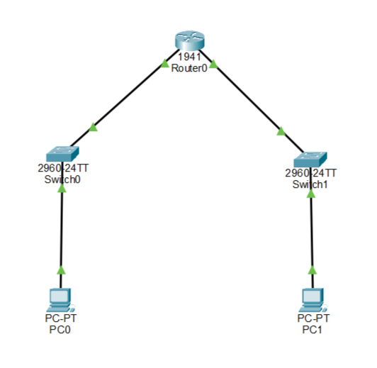
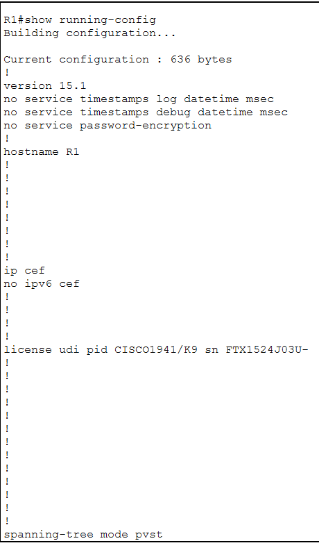
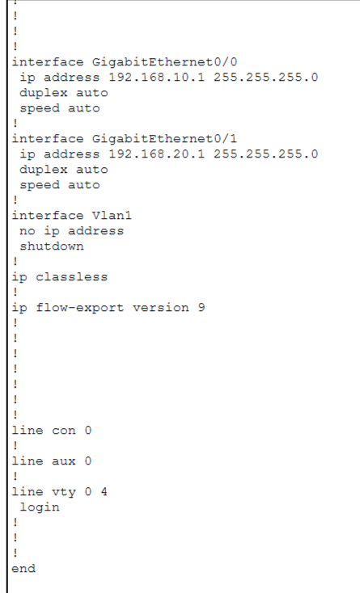
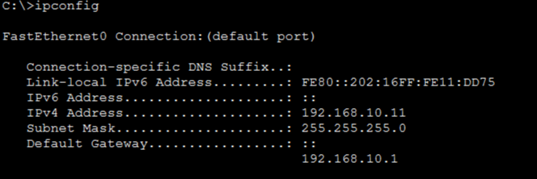
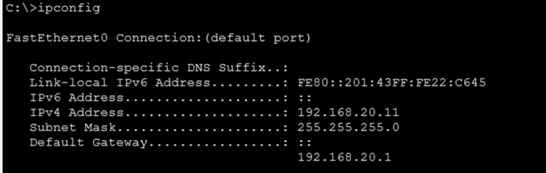
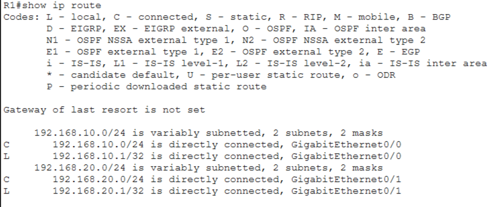
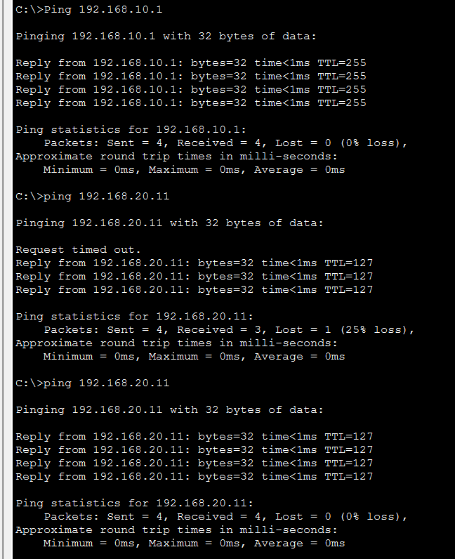

# Lab-07: Two Different Networks Communication

## Overview
In this lab, I configured two different networks using a Cisco 1941 router and two Cisco 2960 switches in Cisco Packet Tracer.

The main objective was to understand how two different networks communicate through a router using directly connected routes and default gateways.

## Objectives
- Create two separate LAN networks.
- Configure router interfaces with IP addresses.
- Configure static IP addresses on PCs.
- Understand the role of a default gateway.
- Verify directly connected routes.
- Test communication between different networks using the ping command.

## Network Topology
The lab consists of:

- 1 Cisco 1941 Router
- 2 Cisco 2960 Switches
- 2 PCs
- Copper Straight-Through Cables



## IP Addressing Table

| Device | Interface | IP Address | Subnet Mask | Default Gateway |
|---|---|---|---|---|
| R1 | G0/0 | 192.168.10.1 | 255.255.255.0 | N/A |
| PC0 | FastEthernet0 | 192.168.10.11 | 255.255.255.0 | 192.168.10.1 |
| R1 | G0/1 | 192.168.20.1 | 255.255.255.0 | N/A |
| PC1 | FastEthernet0 | 192.168.20.11 | 255.255.255.0 | 192.168.20.1 |

## Router Configuration

Configured hostname and IP addresses on both router interfaces.

### Router Configuration - Part 1



### Router Configuration - Part 2



## PC IP Configuration

### PC0 - Network 1



### PC1 - Network 2



## Routing Table Verification

Used the following command to verify the router's routing table:

```bash
show ip route
```

The routing table displayed two directly connected networks:

- C 192.168.10.0/24 — GigabitEthernet0/0
- C 192.168.20.0/24 — GigabitEthernet0/1



## Connectivity Testing

Tested communication from PC0 to PC1 using:

```bash
ping 192.168.20.11
```

**Final Test Results:**
- Packets Sent: 4
- Packets Received: 4
- Packet Loss: 0%

The first ping experienced a timeout during initial ARP resolution. Subsequent ping tests were successful.



## Key Learnings

- Communication between two different networks.
- Router interface configuration.
- Directly connected routes.
- Default gateway functionality.
- Routing table verification.
- Basic network connectivity troubleshooting.

## Conclusion

Successfully configured and tested communication between two different networks using a Cisco router. Both networks communicated successfully through the router with 0% packet loss in the final connectivity test.

## Tools Used

- Cisco Packet Tracer
- Cisco IOS CLI
- Ping Command
- IP Configuration
