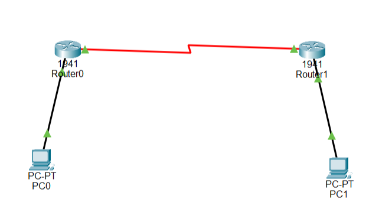
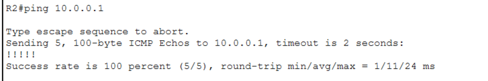
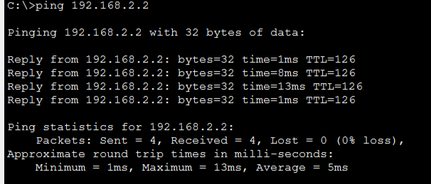

# Lab-08: Static Routing Between Two Networks

## 🎯 Overview

In this lab, I connected two Cisco 1941 routers using a Serial DCE/DTE connection and configured two separate LAN networks.

I implemented static routing to enable communication between two PCs connected to different routers using Cisco Packet Tracer.

## 🎯 Objectives

- Connect two routers using a Serial DCE/DTE link.
- Configure router interfaces with IP addresses.
- Understand /24 and /30 subnet masks.
- Configure static routes on both routers.
- Verify routing tables.
- Test router-to-router connectivity.
- Verify end-to-end communication between two PCs.

## 🛠️ Devices Used

- 2 × Cisco 1941 Routers (R1 and R2)
- 2 × PCs (PC0 and PC1)
- 1 × Serial DCE/DTE Cable
- 2 × Ethernet Cables
- Cisco Packet Tracer

## 🌐 Network Topology

Two separate LAN networks are connected through two Cisco routers using a Serial link.



## 📋 IP Addressing Table

| Device | Interface | IP Address | Subnet Mask |
|---|---|---|---|
| PC0 | FastEthernet0 | 192.168.1.2 | 255.255.255.0 |
| R1 | GigabitEthernet0/0 | 192.168.1.1 | 255.255.255.0 |
| R1 | Serial0/1/0 | 10.0.0.1 | 255.255.255.252 |
| R2 | Serial0/1/0 | 10.0.0.2 | 255.255.255.252 |
| R2 | GigabitEthernet0/0 | 192.168.2.1 | 255.255.255.0 |
| PC1 | FastEthernet0 | 192.168.2.2 | 255.255.255.0 |

## 🚪 Default Gateway Configuration

- PC0: 192.168.1.1
- PC1: 192.168.2.1

## ⚙️ Router Configuration

### Router R1

```bash
enable
configure terminal
hostname R1

interface gigabitEthernet 0/0
ip address 192.168.1.1 255.255.255.0
no shutdown
exit

interface serial 0/1/0
ip address 10.0.0.1 255.255.255.252
no shutdown
exit

ip route 192.168.2.0 255.255.255.0 10.0.0.2

end
```

### Router R2

```bash
enable
configure terminal
hostname R2

interface gigabitEthernet 0/0
ip address 192.168.2.1 255.255.255.0
no shutdown
exit

interface serial 0/1/0
ip address 10.0.0.2 255.255.255.252
no shutdown
exit

ip route 192.168.1.0 255.255.255.0 10.0.0.1

end
```

## 🛣️ Static Routing Configuration

Static routes were configured on both routers to enable communication between the two remote LAN networks.

**R1 Static Route:**

```bash
ip route 192.168.2.0 255.255.255.0 10.0.0.2
```

**R2 Static Route:**

```bash
ip route 192.168.1.0 255.255.255.0 10.0.0.1
```

## 🔍 Verification Commands

The following commands were used to verify router interfaces, configurations, and routing tables.

```bash
show ip interface brief
show ip route
show running-config
```

## 🔗 Router-to-Router Connectivity

Connectivity between R1 and R2 was tested using ping commands.

**R1 to R2:**

```bash
ping 10.0.0.2
```


**R2 to R1:**

```bash
ping 10.0.0.1
```



**Result:** Successful communication between both routers.

## 💻 PC IP Configuration

### PC0 IP Configuration


### PC1 IP Configuration


## 📊 Routing Table Verification

### R1 Routing Table

```bash
show ip route
```


### R2 Routing Table

```bash
show ip route
```


The routing tables were verified to confirm connected and static routes.

## ⚙️ Router Configuration Screenshots

### R1 Configuration


### R2 Configuration


## ✅ End-to-End Connectivity Testing

Communication between PC0 and PC1 was tested using ping commands.

**PC0 to PC1:**

```bash
ping 192.168.2.2
```

**PC1 to PC0:**

```bash
ping 192.168.1.2
```



**Result:** Both PCs successfully communicated with each other with 0% packet loss.

## 📚 Key Learnings

- Router-to-Router Serial Connectivity
- Serial DCE/DTE Connection
- IPv4 Addressing and Subnetting
- Understanding /24 and /30 Subnet Masks
- Router Interface Configuration
- Static Routing Configuration
- Next-Hop IP Address
- Routing Table Verification
- Router-to-Router Connectivity Testing
- End-to-End Network Connectivity
- Basic Network Troubleshooting

## 📊 Lab Results

- Successfully connected two Cisco routers.
- Configured two separate LAN networks.
- Implemented static routing on both routers.
- Verified router interfaces and routing tables.
- Successfully tested communication between R1 and R2.
- Verified successful communication between PC0 and PC1.

## 🎓 Lab Status

**Completed Successfully**

Both routers were configured with static routes, and successful communication was verified between the two routers and both end devices.

---


**Author:** Arsalan Younis

**GitHub:** [Arslan-07](https://github.com/Arslan-07)
