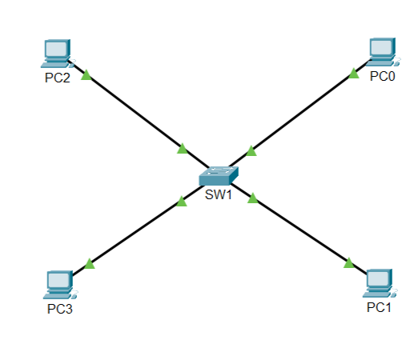
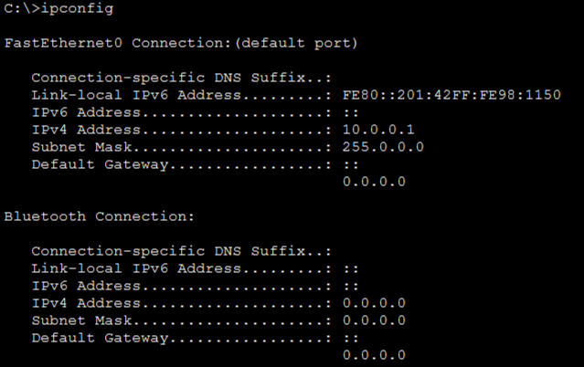
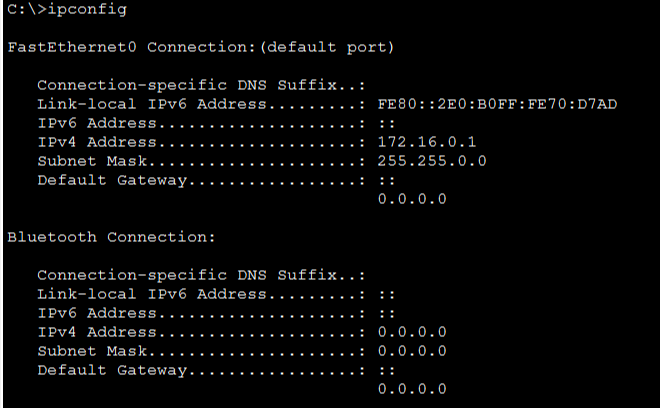
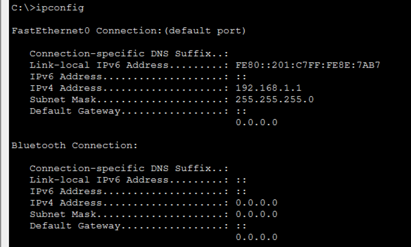
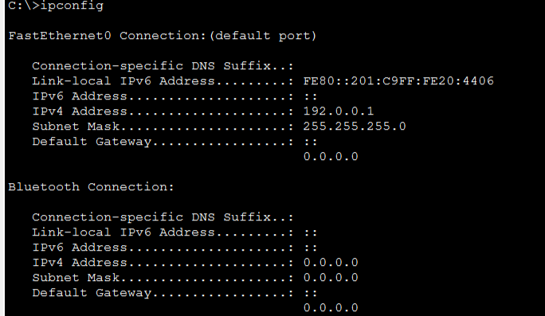
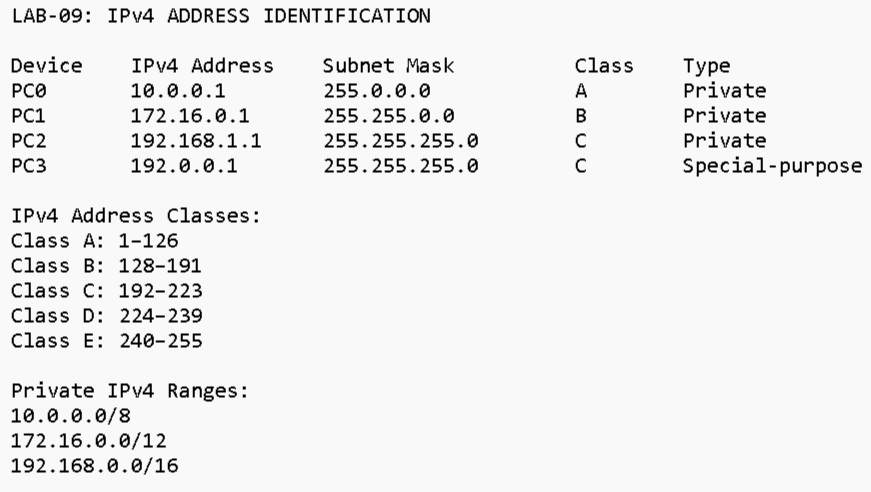

# Lab-09: IPv4 Address Classes and Private/Public IP Addresses

## 🎯 Overview

In this lab, I explored IPv4 addressing, historical IPv4 address classes, default subnet masks, and private versus public IP addresses using Cisco Packet Tracer.

I created a basic network topology consisting of four PCs connected to a Cisco 2960 switch. Each PC was configured with a different IPv4 address to practice identifying IP classes and address types.

## 🎯 Objectives

- Understand IPv4 addressing and its 32-bit structure.
- Identify IPv4 Classes A, B, C, D, and E.
- Understand default subnet masks.
- Identify private IPv4 address ranges.
- Understand public and special-purpose IP addresses.
- Verify IP configurations using the `ipconfig` command.

## 🖥️ Network Topology

The network consists of:

- 4 PCs
- 1 Cisco 2960 Switch
- Copper Straight-Through cables

### Network Topology Diagram



## 🌐 IP Addressing Configuration

The following IPv4 addresses were assigned to the PCs:

| Device | IPv4 Address | Subnet Mask | Class | Address Type |
|---|---|---|---|---|
| PC0 | 10.0.0.1 | 255.0.0.0 | A | Private |
| PC1 | 172.16.0.1 | 255.255.0.0 | B | Private |
| PC2 | 192.168.1.1 | 255.255.255.0 | C | Private |
| PC3 | 192.0.0.1 | 255.255.255.0 | C | Special-purpose |

## 📚 IPv4 Address Classes

IPv4 addresses are 32-bit addresses divided into five historical classes.

| Class | First Octet Range | Default Subnet Mask |
|---|---|---|
| A | 1–126 | 255.0.0.0 |
| B | 128–191 | 255.255.0.0 |
| C | 192–223 | 255.255.255.0 |
| D | 224–239 | Not Applicable |
| E | 240–255 | Not Applicable |

## 🔐 Private IPv4 Address Ranges

Private IPv4 addresses are commonly used in internal networks and are not directly routable over the public internet.

The three private IPv4 ranges are:

- Class A: `10.0.0.0/8`
- Class B: `172.16.0.0/12`
- Class C: `192.168.0.0/16`

## 🔎 IP Configuration Verification

I used the following command on each PC to verify its IPv4 configuration:

```bash
ipconfig
```

The IP addresses and subnet masks were successfully displayed.

## 📸 Practical Screenshots

### PC0 IP Configuration


### PC1 IP Configuration


### PC2 IP Configuration


### PC3 IP Configuration


### IPv4 Address Identification


## 📖 Key Learnings

Through this practical lab, I learned:

- IPv4 addresses consist of 32 bits.
- Historical IPv4 addressing includes Classes A, B, C, D, and E.
- Each class has a different default subnet mask where applicable.
- Private IP addresses are used in internal networks.
- Public and special-purpose IP addresses have different purposes.
- The `ipconfig` command helps verify IP configuration.

## 🛠️ Tools and Technologies

- Cisco Packet Tracer
- IPv4 Addressing
- IP Configuration
- Networking Fundamentals

## ✅ Lab Status

**Completed — IPv4 Address Classes and Private/Public IP Address Identification.**

---


GitHub: [Arslan-07](https://github.com/Arslan-07)
