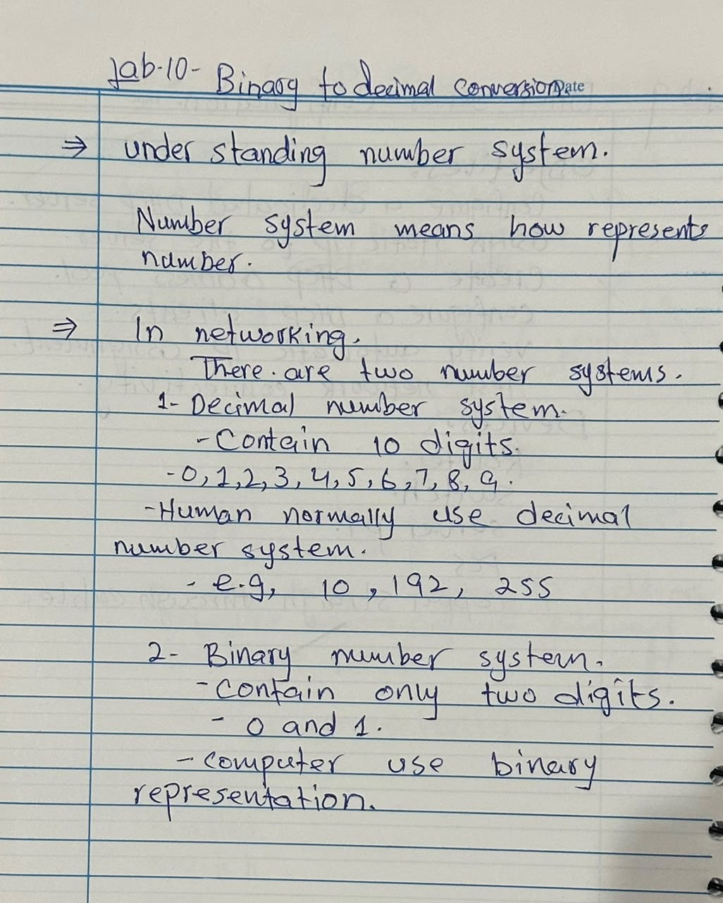
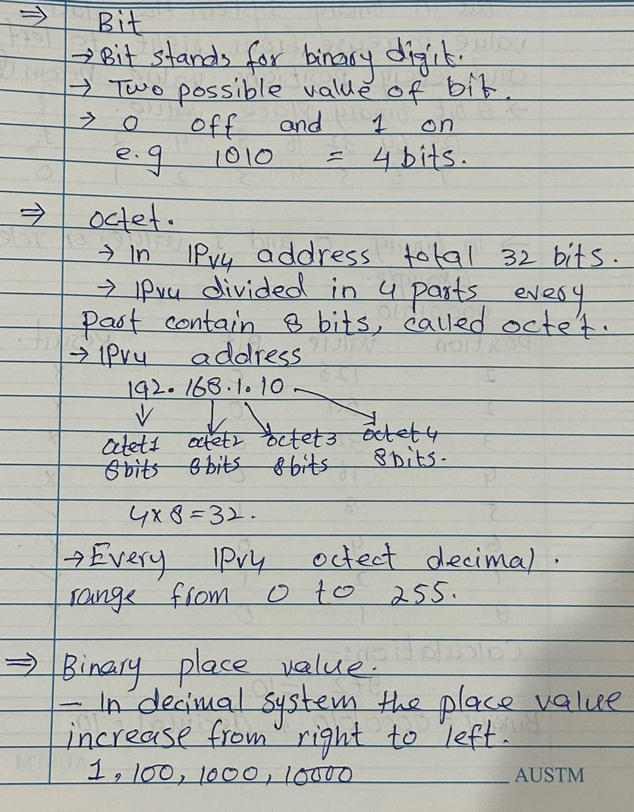
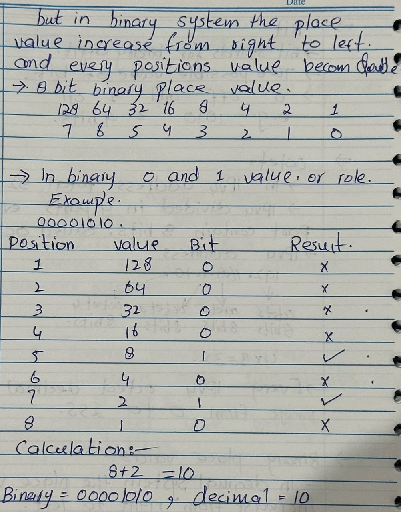
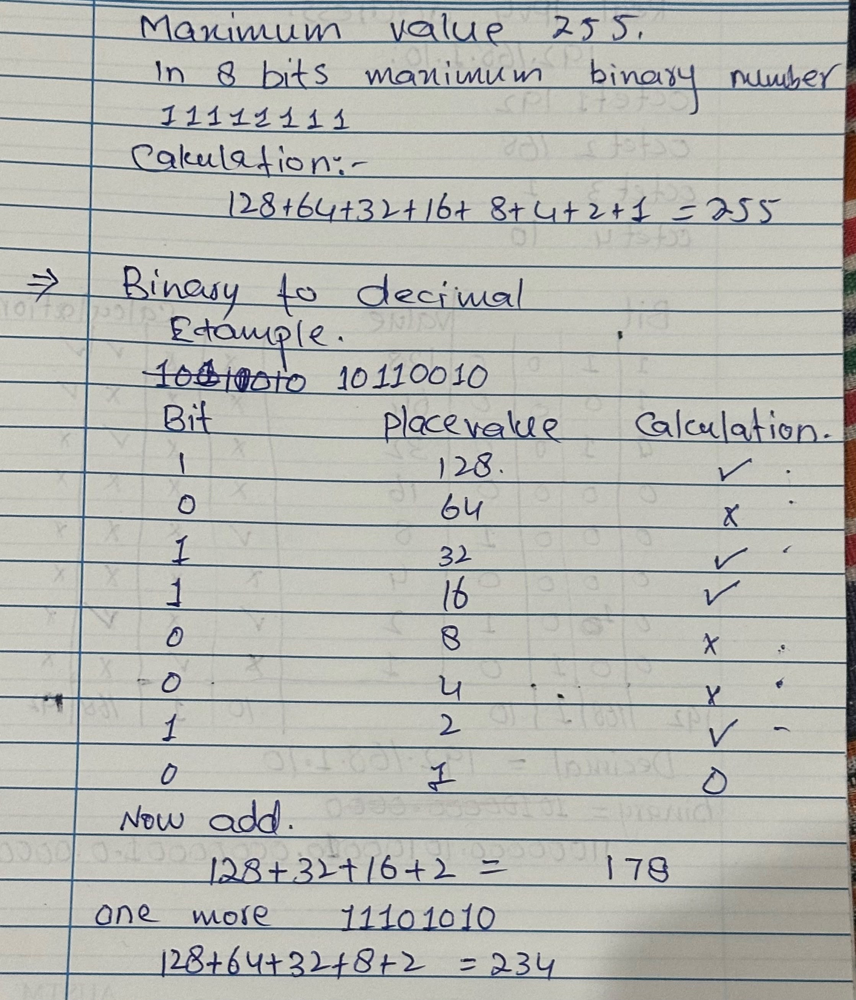
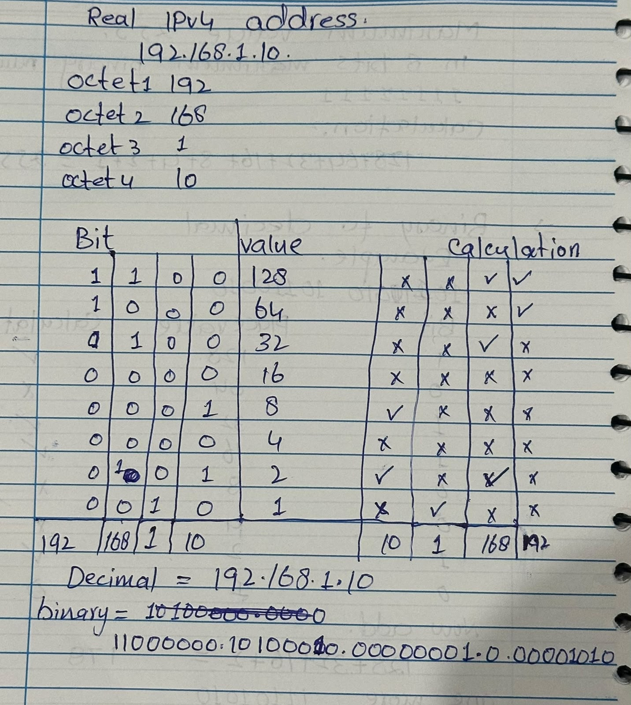

# CCNA Lab 10 – Binary-to-Decimal Conversion

## Lab Overview

This lab covers the fundamentals of Binary and Decimal number systems, 8-bit binary place values, and Binary-to-Decimal conversion.

It also demonstrates how binary numbers are used in IPv4 addressing.

- **Lab Number:** 10
- **Topic:** Binary-to-Decimal Conversion
- **Category:** CCNA – IP Addressing Fundamentals
- **Practice Method:** Handwritten Notes and Manual Calculations

## Learning Objectives

- Understand Decimal and Binary number systems.
- Understand bits, bytes, and octets.
- Learn 8-bit binary place values.
- Calculate the maximum value of an 8-bit binary number.
- Convert binary numbers into decimal values.
- Understand binary representation of IPv4 addresses.

---

## Page 01 – Understanding Number System

A number system is a method of representing numbers using a set of digits and rules.

### 1. Decimal Number System

- Contains 10 digits.
- Digits: 0–9.
- Normally used by humans.
- Examples: 10, 192, 255.

### 2. Binary Number System

- Contains only 2 digits.
- Digits: 0 and 1.
- Computers use binary representation to process and represent data.
- Examples: 1010, 11001, 11000000.

**Key Difference:** Decimal is Base-10, while Binary is Base-2.

### Notebook Evidence

---

## Page 02 – Understanding Bits

A bit stands for Binary Digit.

A bit is the smallest unit of digital data and can have only two possible values:

- 0 = OFF
- 1 = ON

### Bit, Byte and Octet

- 1 bit represents one binary digit.
- 8 bits make 1 byte.
- An IPv4 octet consists of 8 bits.

### IPv4 Structure

An IPv4 address contains 32 bits divided into four octets.

Example:

`192.168.1.10`

- First Octet: 8 bits
- Second Octet: 8 bits
- Third Octet: 8 bits
- Fourth Octet: 8 bits

**Total: 4 × 8 = 32 bits**

### Notebook Evidence

---

## Page 03 – Binary Place Values (Right to Left)

In the Binary number system, place values increase from right to left.

Each position has double the value of the position immediately to its right.

### 8-Bit Binary Place Value Table

| Position | Place Value |
|---:|---:|
| 1 | 128 |
| 2 | 64 |
| 3 | 32 |
| 4 | 16 |
| 5 | 8 |
| 6 | 4 |
| 7 | 2 |
| 8 | 1 |

Place values from right to left:

`1, 2, 4, 8, 16, 32, 64, 128`

### Role of 0 and 1

- If a bit is 1, its corresponding place value is included.
- If a bit is 0, its corresponding place value is ignored.

### Example

Binary: `00001010`

Calculation:

8 + 2 = 10

**Answer: 00001010 = 10**

### Notebook Evidence

---

## Page 04 – Maximum Value 255 in 8 Bits

The maximum possible unsigned 8-bit binary number is:

`11111111`

### Calculation

128 + 64 + 32 + 16 + 8 + 4 + 2 + 1 = 255

### 8-Bit Range

- Minimum value: 0 (`00000000`)
- Maximum value: 255 (`11111111`)

Therefore, an 8-bit unsigned binary number has a decimal range of 0–255.

### Binary-to-Decimal Example 1

Binary: `10110010`

Calculation:

128 + 32 + 16 + 2 = 178

**Answer: 10110010 = 178**

### Binary-to-Decimal Example 2

Binary: `11101010`

Calculation:

128 + 64 + 32 + 8 + 2 = 234

**Answer: 11101010 = 234**

### Notebook Evidence

---

## Page 05 – Real IPv4 Address Conversion

In networking, IPv4 addresses are normally written in decimal dotted-decimal format.

### Example IPv4 Address

`192.168.1.10`

Each decimal octet can be represented using 8 binary bits.

### Decimal-to-Binary Conversion

| Decimal Octet | Binary Representation |
|---:|---|
| 192 | 11000000 |
| 168 | 10101000 |
| 1 | 00000001 |
| 10 | 00001010 |

### Complete Binary IPv4 Address

`11000000.10101000.00000001.00001010`

### Verification

- 192 = 128 + 64
- 168 = 128 + 32 + 8
- 1 = 1
- 10 = 8 + 2

This confirms the decimal and binary representations of the IPv4 address.

### Notebook Evidence

---

## Practical Applications in Networking

Binary conversion is important for understanding:

- IPv4 Addressing
- Subnet Masks
- Network Addresses
- Broadcast Addresses
- Network and Host Portions
- Subnetting

## Lab Summary

In this lab, I learned:

1. Decimal and Binary number systems.
2. Bits, bytes, and octets.
3. Binary place values.
4. Maximum 8-bit value (255).
5. Binary-to-Decimal conversion.
6. IPv4 address binary representation.

## Skills Practiced

- Binary Number System
- Decimal Number System
- Bit and Octet Fundamentals
- Binary Place Values
- Binary-to-Decimal Conversion
- IPv4 Address Representation
- Manual Calculations

---

## Notebook Pages

| File | Description |
|---|---|
| notebook-page-01.png | Understanding Number System |
| notebook-page-02.png | Understanding Bits |
| notebook-page-03.png | Binary Place Values |
| notebook-page-04.png | Maximum Value 255 and Conversion |
| notebook-page-05.png | Real IPv4 Address Conversion |

---
