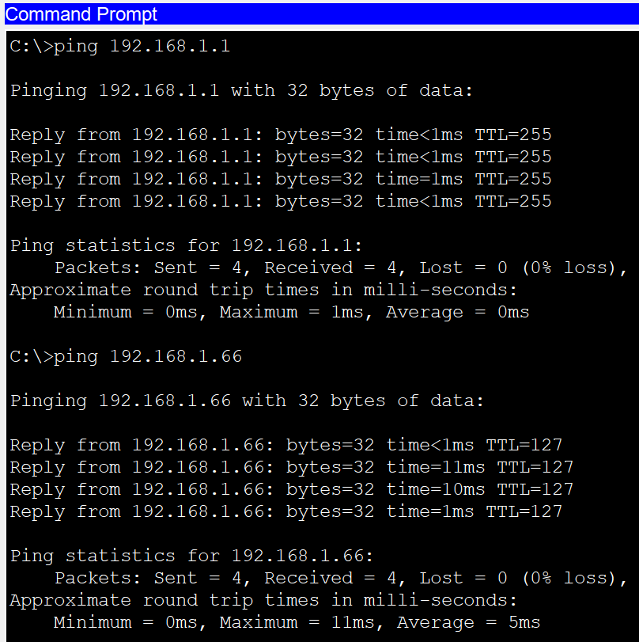
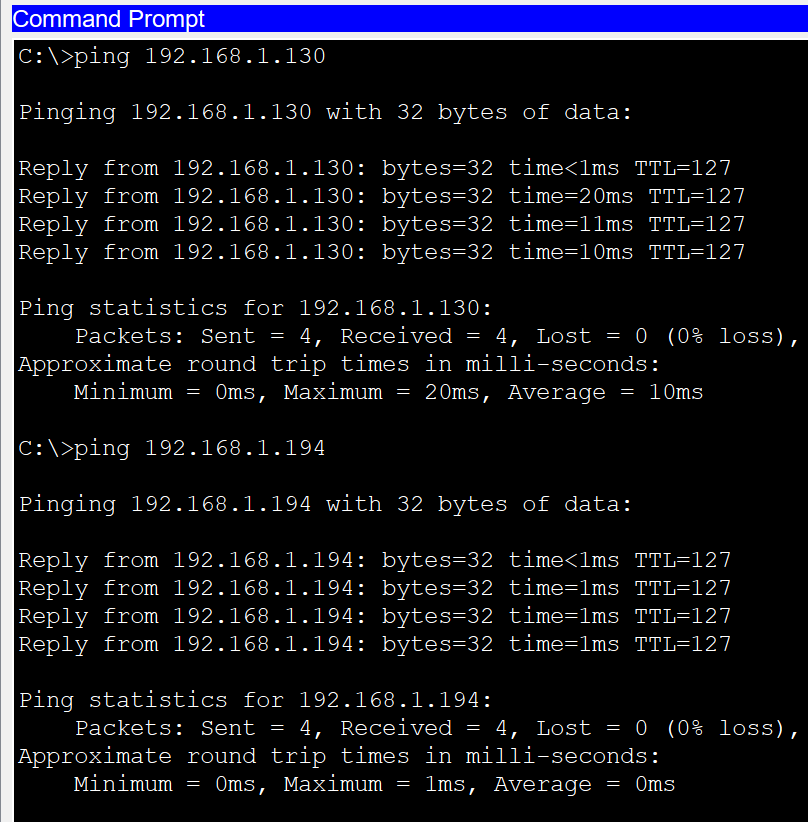

# Lab 12 – Subnetting: Equal Size Subnets

## Overview

This lab demonstrates Equal Size Subnetting by dividing a single IPv4 network into four equal-sized subnets. It also implements VLANs and Inter-VLAN Routing using the Router-on-a-Stick configuration in Cisco Packet Tracer.

## Objectives

- Understand Equal Size Subnetting.
- Divide a `/24` network into four equal subnets.
- Calculate Network ID, usable IP range, and Broadcast Address.
- Configure four VLANs for different departments.
- Configure trunk links using IEEE 802.1Q.
- Implement Router-on-a-Stick Inter-VLAN Routing.
- Verify connectivity between different VLANs using ping.

## Network Topology and Subnetting

The network consists of:

- 1 Cisco 2811 Router
- 1 Central Cisco 2960 Switch
- 4 Access Cisco 2960 Switches
- 8 PCs
- 4 VLANs

### Topology Diagram


## Subnetting Calculations

**Original Network:** `192.168.1.0/24`

| Parameter | Value |
|---|---|
| Original CIDR | /24 |
| Required Subnets | 4 |
| Borrowed Bits | 2 |
| New CIDR | /26 |
| Subnet Mask | 255.255.255.192 |
| Block Size | 64 |
| Total IPs per Subnet | 64 |
| Usable Hosts per Subnet | 62 |

### Subnet Allocation Table

| VLAN | Department | Network ID | First Usable IP | Last Usable IP | Broadcast |
|---|---|---|---|---|---|
| 10 | ADMIN | 192.168.1.0 | 192.168.1.1 | 192.168.1.62 | 192.168.1.63 |
| 20 | HR | 192.168.1.64 | 192.168.1.65 | 192.168.1.126 | 192.168.1.127 |
| 30 | IT | 192.168.1.128 | 192.168.1.129 | 192.168.1.190 | 192.168.1.191 |
| 40 | SALES | 192.168.1.192 | 192.168.1.193 | 192.168.1.254 | 192.168.1.255 |

## IP Address Configuration

| VLAN | Default Gateway | PC 1 | PC 2 |
|---|---|---|---|
| 10 – ADMIN | 192.168.1.1 | 192.168.1.2 | 192.168.1.3 |
| 20 – HR | 192.168.1.65 | 192.168.1.66 | 192.168.1.67 |
| 30 – IT | 192.168.1.129 | 192.168.1.130 | 192.168.1.131 |
| 40 – SALES | 192.168.1.193 | 192.168.1.194 | 192.168.1.195 |

**Subnet Mask for all PCs:** `255.255.255.192`

## Configuration and Implementation

The following networking technologies and configurations were implemented:

1. Created VLANs 10, 20, 30, and 40.
2. Assigned access ports to their respective VLANs.
3. Configured trunk links between the central switch and access switches.
4. Configured the router-facing switch port as a trunk.
5. Enabled the router's physical GigabitEthernet interface.
6. Created router subinterfaces for VLANs 10, 20, 30, and 40.
7. Configured IEEE 802.1Q encapsulation on router subinterfaces.
8. Assigned gateway IP addresses to the router subinterfaces.
9. Verified network connectivity using ping tests.

### Router-on-a-Stick Configuration

| Subinterface | VLAN | Gateway IP |
|---|---|---|
| G0/0.10 | 10 | 192.168.1.1 |
| G0/0.20 | 20 | 192.168.1.65 |
| G0/0.30 | 30 | 192.168.1.129 |
| G0/0.40 | 40 | 192.168.1.193 |

## Connectivity Verification

Connectivity was tested from PC0 (ADMIN – VLAN 10) to the default gateway and PCs in the other three VLANs.

### Ping Verification – 1

Tests:
- PC0 to Default Gateway: `192.168.1.1`
- PC0 to HR PC: `192.168.1.66`



### Ping Verification – 2

Tests:
- PC0 to IT PC: `192.168.1.130`
- PC0 to SALES PC: `192.168.1.194`



### Verification Results

| Source | Destination | Result |
|---|---|---|
| PC0 – VLAN 10 | Gateway – 192.168.1.1 | Successful |
| PC0 – VLAN 10 | PC2 – 192.168.1.66 | Successful |
| PC0 – VLAN 10 | PC4 – 192.168.1.130 | Successful |
| PC0 – VLAN 10 | PC6 – 192.168.1.194 | Successful |

All final connectivity tests completed successfully with **0% packet loss**.

## Commands Used for Verification

```cisco
show vlan brief
show interfaces trunk
show mac address-table
show ip interface brief
```

Connectivity testing:

```text
ping 192.168.1.1
ping 192.168.1.66
ping 192.168.1.130
ping 192.168.1.194
```

## Files Included

| File | Description |
|---|---|
| `Lab-12.pkt` | Complete Cisco Packet Tracer project |
| `Topology + Subnetting Table.png` | Network topology and subnetting calculations |
| `Ping-Verification-1.png` | Gateway and VLAN 20 connectivity evidence |
| `Ping-Verification-2.png` | VLAN 30 and VLAN 40 connectivity evidence |

## Learning Outcomes

Through this lab, I practiced:

- IPv4 subnetting and equal-sized subnet calculation.
- Network ID, usable host range, and broadcast address identification.
- VLAN creation and access port configuration.
- 802.1Q trunk configuration.
- Router-on-a-Stick implementation.
- Inter-VLAN Routing.
- Network troubleshooting and connectivity verification.

---

**Tool:** Cisco Packet Tracer

**Topic:** CCNA – IPv4 Subnetting and Inter-VLAN Routing
