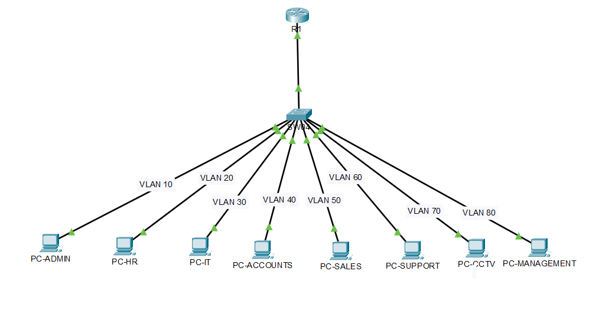
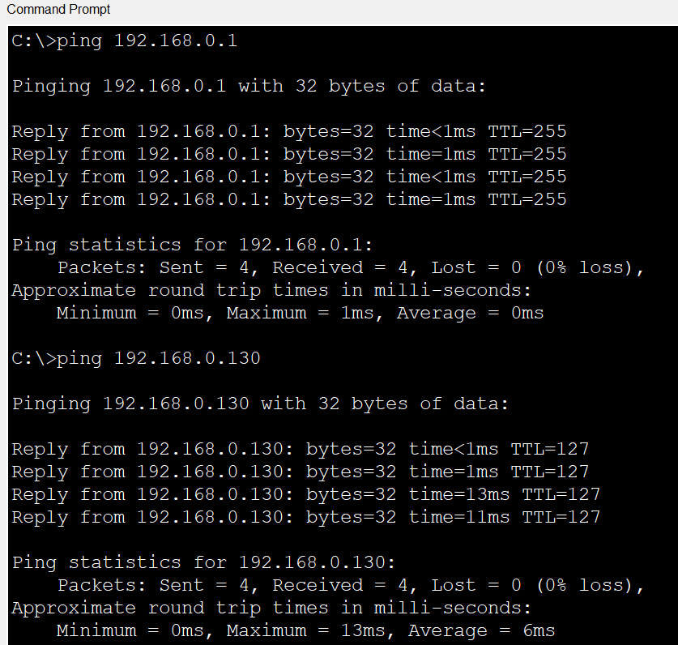
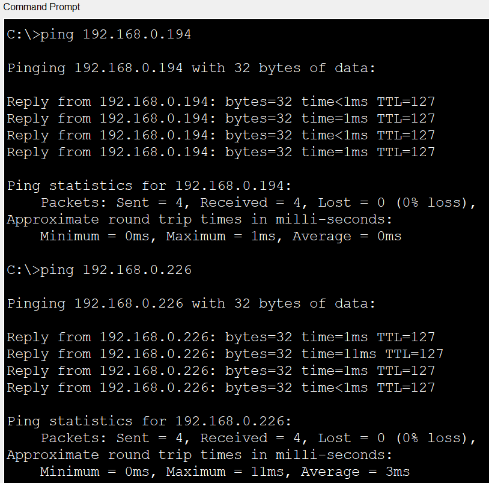
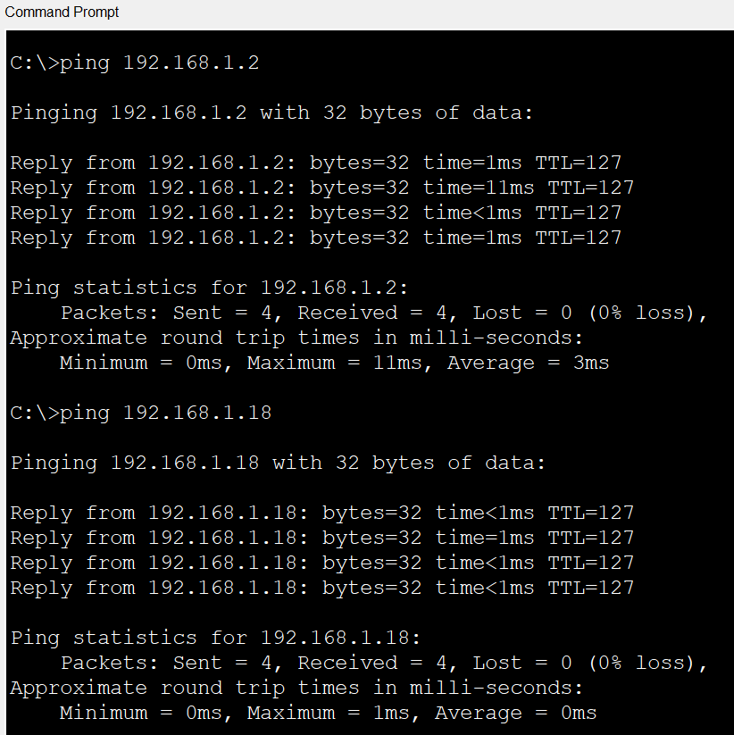
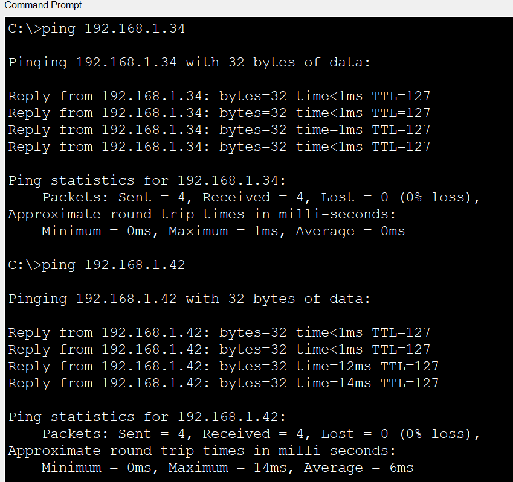
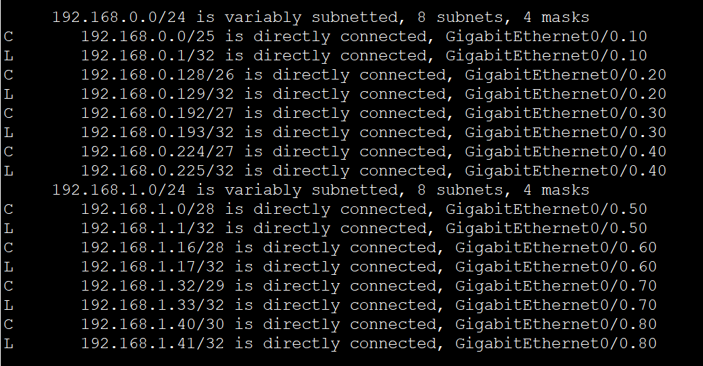

# CCNA Lab 13 – VLSM Subnetting


## 1. Lab Overview

This lab demonstrates **Variable Length Subnet Masking (VLSM)** using Cisco Packet Tracer.

The objective is to divide a parent network into multiple subnets of different sizes according to the host requirements of eight departments. VLANs, trunking, and Router-on-a-Stick are configured to enable communication between departments.

## 2. Network Requirements

The following departments require different numbers of hosts:

| Department | VLAN ID | Required Hosts |
|---|---:|---:|
| ADMIN | 10 | 100 |
| HR | 20 | 50 |
| IT | 30 | 25 |
| ACCOUNTS | 40 | 20 |
| SALES | 50 | 12 |
| SUPPORT | 60 | 10 |
| CCTV | 70 | 5 |
| MANAGEMENT | 80 | 2 |

**Parent Network:** `192.168.0.0/23`

**Subnet Mask:** `255.255.254.0`

## 3. VLSM Subnetting Table

Subnets were allocated from largest to smallest host requirements to minimize IP address wastage.

| Department | VLAN | Network Address | Prefix | Subnet Mask | Usable IP Range | Broadcast Address |
|---|---:|---|---:|---|---|---|
| ADMIN | 10 | 192.168.0.0 | /25 | 255.255.255.128 | 192.168.0.1 – 192.168.0.126 | 192.168.0.127 |
| HR | 20 | 192.168.0.128 | /26 | 255.255.255.192 | 192.168.0.129 – 192.168.0.190 | 192.168.0.191 |
| IT | 30 | 192.168.0.192 | /27 | 255.255.255.224 | 192.168.0.193 – 192.168.0.222 | 192.168.0.223 |
| ACCOUNTS | 40 | 192.168.0.224 | /27 | 255.255.255.224 | 192.168.0.225 – 192.168.0.254 | 192.168.0.255 |
| SALES | 50 | 192.168.1.0 | /28 | 255.255.255.240 | 192.168.1.1 – 192.168.1.14 | 192.168.1.15 |
| SUPPORT | 60 | 192.168.1.16 | /28 | 255.255.255.240 | 192.168.1.17 – 192.168.1.30 | 192.168.1.31 |
| CCTV | 70 | 192.168.1.32 | /29 | 255.255.255.248 | 192.168.1.33 – 192.168.1.38 | 192.168.1.39 |
| MANAGEMENT | 80 | 192.168.1.40 | /30 | 255.255.255.252 | 192.168.1.41 – 192.168.1.42 | 192.168.1.43 |

## 4. Network Topology

The lab uses the following network devices:

- 1 Cisco 1941 Router
- 1 Cisco 2960 Switch
- 8 PCs (one for each department)

The router connects to the switch through a trunk link using GigabitEthernet0/0 on the router and GigabitEthernet0/1 on the switch.



## 5. VLAN Configuration

Eight VLANs were created on the Cisco 2960 switch.

| VLAN ID | VLAN Name | Switch Port |
|---:|---|---|
| 10 | ADMIN | Fa0/1 |
| 20 | HR | Fa0/2 |
| 30 | IT | Fa0/3 |
| 40 | ACCOUNTS | Fa0/4 |
| 50 | SALES | Fa0/5 |
| 60 | SUPPORT | Fa0/6 |
| 70 | CCTV | Fa0/7 |
| 80 | MANAGEMENT | Fa0/8 |

Each PC is connected to an access port assigned to its respective VLAN.

## 6. Trunk Configuration

The connection between the router and switch was configured as an 802.1Q trunk.

```cisco
interface gigabitEthernet 0/1
switchport mode trunk
switchport trunk allowed vlan 10,20,30,40,50,60,70,80
no shutdown
```

All eight VLANs were verified as allowed, active, and forwarding on the trunk.

## 7. Router-on-a-Stick Configuration

Router-on-a-Stick was implemented using eight logical subinterfaces on the router's GigabitEthernet0/0 physical interface.

```cisco
interface gigabitEthernet 0/0.10
encapsulation dot1Q 10
ip address 192.168.0.1 255.255.255.128

interface gigabitEthernet 0/0.20
encapsulation dot1Q 20
ip address 192.168.0.129 255.255.255.192

interface gigabitEthernet 0/0.30
encapsulation dot1Q 30
ip address 192.168.0.193 255.255.255.224

interface gigabitEthernet 0/0.40
encapsulation dot1Q 40
ip address 192.168.0.225 255.255.255.224

interface gigabitEthernet 0/0.50
encapsulation dot1Q 50
ip address 192.168.1.1 255.255.255.240

interface gigabitEthernet 0/0.60
encapsulation dot1Q 60
ip address 192.168.1.17 255.255.255.240

interface gigabitEthernet 0/0.70
encapsulation dot1Q 70
ip address 192.168.1.33 255.255.255.248

interface gigabitEthernet 0/0.80
encapsulation dot1Q 80
ip address 192.168.1.41 255.255.255.252
```

The first usable IP address of each subnet was assigned as its default gateway.

## 8. PC IP Addressing

| PC | IP Address | Subnet Mask | Default Gateway |
|---|---|---|---|
| PC-ADMIN | 192.168.0.2 | 255.255.255.128 | 192.168.0.1 |
| PC-HR | 192.168.0.130 | 255.255.255.192 | 192.168.0.129 |
| PC-IT | 192.168.0.194 | 255.255.255.224 | 192.168.0.193 |
| PC-ACCOUNTS | 192.168.0.226 | 255.255.255.224 | 192.168.0.225 |
| PC-SALES | 192.168.1.2 | 255.255.255.240 | 192.168.1.1 |
| PC-SUPPORT | 192.168.1.18 | 255.255.255.240 | 192.168.1.17 |
| PC-CCTV | 192.168.1.34 | 255.255.255.248 | 192.168.1.33 |
| PC-MANAGEMENT | 192.168.1.42 | 255.255.255.252 | 192.168.1.41 |

## 9. Connectivity Testing

Connectivity was tested using the `ping` command from PC-ADMIN to its default gateway and all other department PCs.

| Destination | Department | Result |
|---|---|---|
| 192.168.0.1 | ADMIN Gateway | Successful |
| 192.168.0.130 | HR | Successful |
| 192.168.0.194 | IT | Successful |
| 192.168.0.226 | ACCOUNTS | Successful |
| 192.168.1.2 | SALES | Successful |
| 192.168.1.18 | SUPPORT | Successful |
| 192.168.1.34 | CCTV | Successful |
| 192.168.1.42 | MANAGEMENT | Successful |

**Result:** All tested destinations responded successfully with 0% packet loss.

### Ping Test Screenshots









## 10. Routing Table Verification

The router routing table was verified using:

```cisco
show ip route
```

All eight department networks appeared as directly connected routes (`C`), with their respective local interface routes (`L`).



## 11. Verification Commands

The following commands were used during the lab:

**Router:**

```cisco
show ip interface brief
show ip route
```

**Switch:**

```cisco
show vlan brief
show interfaces trunk
```

**PC:**

```text
ping <destination-ip>
```

## 12. Skills Learned

- IPv4 subnetting and VLSM calculations
- Network ID, usable IP range, and broadcast address identification
- VLAN creation and port assignment
- Access port and trunk port configuration
- IEEE 802.1Q VLAN tagging
- Router-on-a-Stick configuration
- Inter-VLAN routing
- Default gateway configuration
- Routing table verification
- Network connectivity troubleshooting

## 13. Lab Conclusion

Successfully designed and implemented an eight-department network using VLSM, VLAN segmentation, and Router-on-a-Stick inter-VLAN routing in Cisco Packet Tracer.

All eight router subinterfaces were operational, all VLANs were forwarding on the trunk, and connectivity tests confirmed successful communication between the tested departments.

**Lab Status: Completed Successfully.**

