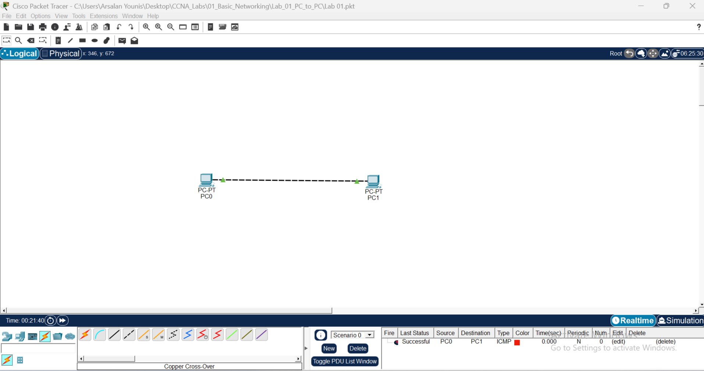

# Cisco Packet Tracer – Networking Labs

This repository contains practical networking labs created using **Cisco Packet Tracer** as part of my CCNA learning journey.

## Lab 01: Direct PC-to-PC Connectivity

### Objective
Establish direct communication between two PCs using an Ethernet connection and verify connectivity through the ping command.

### Network Topology
- 2 PCs
- 1 Direct Ethernet connection
- No network switch or router



### IP Addressing

| Device | IP Address | Subnet Mask |
|---|---|---|
| PC1 | 192.168.1.1 | 255.255.255.0 |
| PC2 | 192.168.1.2 | 255.255.255.0 |

### Configuration Steps
1. Add two PCs in Cisco Packet Tracer.
2. Connect both PCs directly using an Ethernet cable.
3. Assign IP addresses to both PCs.
4. Verify network connectivity using the ping command.

### Connectivity Verification

Test connectivity from PC1 to PC2:

```bash
ping 192.168.1.2
```

**Result:** Successful communication between both PCs.

### Skills Practiced
- LAN fundamentals
- Basic network topology
- Direct PC-to-PC connectivity
- IPv4 addressing
- ### PC0 IP Configuration Screenshot


### PC1 IP Configuration Screenshot


- Subnet masks
- Basic network troubleshooting
- Ping connectivity testing

### Project File
`packetTracer-Lab-01.pkt`

---

**Tool:** Cisco Packet Tracer  
**Learning Path:** CCNA  
**Author:** Arsalan Younis
